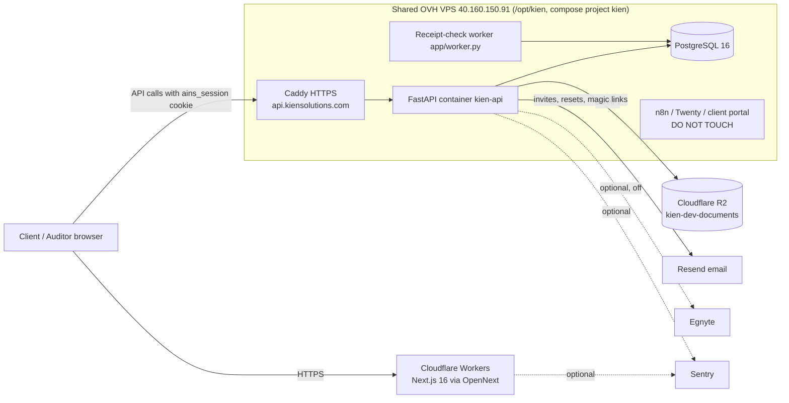

# Architecture

> **Branch status (checked 29 Oct 2026):** `main` is at merge `12f6f70` (PR #52), Alembic head `a111`. PRs **#53–#60 are NOT merged into `main`**; they are a stack (#53 → #54 → #55 → #56 → #57 → #58 → #59 → #60) on top of `main` and are visible only on preview (preview.kiensolutions.com; #59 on layout.kiensolutions.com). Anything tagged **Preview (#NN)** below is not in a fresh `main` checkout. The shared OVH backend already runs the stacked code (`02c480c`, DB at `a115`), so the API serves these routes even though `main` does not contain them.

## Current production (owner-supplied runtime; code supports it)

Workers: live `kien-demo-live` (live.kiensolutions.com), preview `kien-signin-preview` (preview.kiensolutions.com), layout `kien-shadcn-preview` (layout.kiensolutions.com), design `kien-design-preview` (design.kiensolutions.com). Marketing site at kiensolutions.com/www is a separate landing Worker (per `tenant.ts`). All Workers share the one OVH backend (inferred).

## Request flow (upload example)
1. Browser resolves firm from host (`<slug>.kiensolutions.com`) and loads branding.
2. Client drops files → browser posts multipart to FastAPI with session cookie.
3. FastAPI checks session, firm ownership, engagement, file type/size/name (≤100 MB), hashes bytes (SHA-256), writes object to storage under a firm-scoped key, saves metadata in `documents`.
4. API enqueues a `check_jobs` row; `app/worker.py` claims it and verifies receipt/integrity metadata only (no content reading, no model).
5. Auditor routes check auditor role + assignment, write decisions, and append a hash-chained `audit_logs` event in the same transaction.
6. Client sees a neutral status; never findings or internal notes.

## Boundaries
- **Browser:** rendering and UX validation only. Cannot grant access. `NEXT_PUBLIC_*` values are public.
- **FastAPI:** the only data boundary — auth, roles, tenant checks, validation, storage writes, audit chain, reports.
- **Postgres:** no RLS; isolation is by explicit `firm_id` filters and assignment checks in code.
- **No model inference anywhere in `app/`** (enforced by `tests/test_workflow_boundary.py`). Future AI must be a separate, authenticated adapter.

## Repo layout
| Path | Purpose |
| --- | --- |
| `app/main.py` | FastAPI app, routers, `/health` |
| `app/config.py` | Settings from env vars |
| `app/auth/` | Password, sessions, invitations, reset, magic link, MFA, Resend email; `onboarding.py` preview only (#57) |
| `app/api/` | engagements, questionnaire, intake (feedback), manual_review (workspace, pipeline, tasks), auditor, audit_log; `reports.py` (#56) and `invoices.py` (#53) and the direct N/A route (#55/#58) are preview only |
| `app/database/` | SQLAlchemy models, session |
| `app/documents/`, `app/storage/s3.py` | Upload ingestion; S3-compatible storage (R2 today) |
| `app/checklist/`, `data/checklist/` | Catalog and statuses |
| `app/checks/`, `app/worker.py` | Receipt checks and Postgres queue |
| `app/audit.py`, `app/evidence.py` | Audit chain, evidence helpers |
| `app/reports/`, `templates/report/` | Draft report generation |
| `app/invoicing.py` | Invoice arithmetic/numbering/transitions — preview only (#53) |
| `app/*_seed.py` | Synthetic demo seeds (demo on `main`; invoice, report, monday, onboarding seeds preview only) |
| `app/egnyte_client/` | Optional Egnyte client, path guard `/Shared/AINS-Dev` |
| `migrations/versions/` | Alembic chain; `main` head `a111_unassigned_documents`; `a112`–`a115` (head `a115_user_onboarding`) preview only |
| `web/` | Next.js app; `wrangler.jsonc`, `open-next.config.ts` (`wrangler.preview.jsonc`/`wrangler.layout.jsonc` preview only, #60) |
| `web/e2e/` | Playwright tests (19 specs on `main`; 25 with the preview stack) |
| `infra/aws/` | Terraform single-host AWS profile (not in use) |
| `.github/workflows/ci.yml` | CI |
| `.impeccable/` | Impeccable design review and design.json — preview only (#59) |

## Background jobs
Only one: the receipt-check worker (Postgres-backed queue, states queued/running/succeeded/failed). Retry/stale-job operations are not documented. No cron jobs in repo. (On AWS Terraform: daily `pg_dump` timer.)
