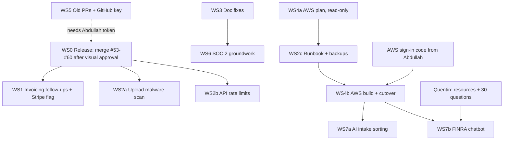

# Historical Claude Code orchestration reference

The prompts below are reference only and do not authorize agents, AWS operations, deployments or AI work. The current [build order](15-roadmap-build-order.md) takes precedence. No AI feature, server operation, merge or deployment belongs to the current task.

The lead (orchestrator) thread owns planning, PR creation, merges, deploys to live, and reporting to Abdullah. Worker threads each own one branch. Abdullah only reviews visuals.

## Workstreams and dependencies

| WS | Can start | Parallel with | Touches |
| --- | --- | --- | --- |
| 0 Release | After Abdullah approves | — | merges, live deploy (lead only) |
| 1 Invoicing + Stripe | After WS0 | 2a, 2b, 3, 4a | `app/invoicing.py`, `app/api/invoices.py`, invoice web pages, new migration |
| 2a Malware scan | After WS0 | 1, 2b, 3 | `app/documents/`, worker, compose |
| 2b Rate limits | After WS0 | 1, 2a, 3 | `app/main.py` middleware, auth |
| 2c Runbook + backups | After 4a | 1, 2a, 2b | docs, scripts (no prod changes without OK) |
| 3 Doc fixes | Now | all | `docs/*`, `AGENTS.md`, `CLAUDE.md` only |
| 4a AWS plan | Now (read-only) | all | `docs/aws/*` |
| 4b AWS build | After 2c + sign-in code + plan approval | — | `infra/aws`, deploy |
| 5 Old PRs | Now (triage only) | all | none (report) |
| 6 SOC 2 | After 3 | 1, 2 | `docs/compliance/*` |
| 7a / 7b AI | After 4b (+ Quentin input for 7b) | each other | new adapter module, web panel |
Until WS0 is done, `main` lacks #53–#60 (invoicing, N/A, reports, onboarding, layout). Prompts below that say "from main" assume WS0 has merged; before that, branch from `fix/onboarding-once` if the work needs those features.

Avoid two threads editing the same doc section: code threads edit only their own feature's section. Run WS3 early; other branches pick up its changes by merging main in with a real merge commit (never rebase).

## Shared preamble (paste at the top of every thread prompt)
```
You are working in the Kien repo (abdullah-kynetic/ains-platform). Kien by Kien Solutions is workflow software for independent AML testing of broker-dealers under FINRA Rule 3310. Quentin Koch (spell it Quentin) is the partner auditor who signs reports.
Read first: AGENTS.md, CLAUDE.md, docs/kb/00-INDEX.md (main vs preview status), PRODUCT.md and DESIGN.md if present (they arrive with #59), docs/PRD.md, docs/ARCHITECTURE.md, docs/DATABASE.md, docs/SECURITY.md, docs/CODE_STYLE.md, docs/TESTING.md, docs/DESIGN_SYSTEM.md.
Hard rules:
- SAR material never goes to any AI model. Synthetic data only; never open real client documents.
- Never read .env or print/commit secrets; refer to env var names only.
- No model SDKs in app/ (tests/test_workflow_boundary.py must pass).
- Server-side tenant checks (firm_id + auditor assignment); add cross-tenant denial tests for new endpoints.
- Don't redesign the look (ink #33405C, ochre #B8924A, neutral white/gray surfaces, dark #0A0A0A). UI changes need before/after screenshots: desktop light, desktop dark, phone.
- Commit as abdullah-kynetic <211030198+abdullah-kynetic@users.noreply.github.com>. Real merge commits only; no rebase, squash or force-push.
- Do not deploy to live, run production migrations, touch the OVH server, AWS, n8n, Twenty or the client portal unless this prompt explicitly says so.
- Keep costs minimal. Keep changes small, typed, tested.
Checks: uv run ruff check . && uv run pytest -q ; in web/: npm run lint && npm run typecheck && npm run test:unit && npm run build:cloudflare && npm run test:e2e
Finish with a report: what changed, exact commands run and results, screenshots, risks, open questions. Never claim unrun checks passed.
```

## Thread prompts

### WS1 — Invoicing follow-ups + Stripe behind a flag
```
[preamble]
Branch feat/invoice-followups from main. Add: (1) overdue/follow-up view and auditor-triggered reminder emails via the existing Resend email module (synthetic recipients in tests; nothing sent automatically); (2) Stripe payment links/checkout behind a feature flag STRIPE_ENABLED (default false), Stripe keys as env var names only, webhook endpoint that verifies signatures and records a payment as an invoice event (idempotent). Additive migration only. Clients still have no invoice access unless a separate pay-link page is explicitly scoped. Tests: flag off = no Stripe calls; webhook signature failure; double webhook; cross-firm denial. Update PRD/ARCHITECTURE/DATABASE/SECURITY/TESTING invoice sections.
```

### WS2a — Malware scan on uploads
```
[preamble]
Branch feat/upload-malware-scan from main. Add a scan step to the receipt-check worker using ClamAV (clamd sidecar in compose; no paid service). New document state "quarantined" hidden from auditors' normal views with a neutral client message ("file could not be accepted, please re-upload"). EICAR test string only for tests. Fail closed if the scanner is down (mark pending, retry). Document resource cost (ClamAV RAM) for the t4g.micro AWS profile.
```

### WS2b — API rate limits
```
[preamble]
Branch feat/api-rate-limits from main. Add general per-IP and per-user rate limits (Postgres-backed like auth_rate_limits; no Redis) for uploads, invitations, password reset and public auth endpoints, plus account lockout policy for repeated failed sign-ins with safe unlock. Respect that Caddy is the proxy; don't trust forwarded headers unless configured. Tests for limits and lockout.
```

### WS2c — Ops runbook + backups
```
[preamble]
Branch docs/ops-runbook. Write docs/OPERATIONS.md: health checks, logs, worker queue recovery, deploy/rollback (compose override files, wrangler rollback), incident steps, secret rotation, and a scheduled encrypted off-site Postgres backup + restore drill design for both OVH and AWS. Add scripts only as files; do not run anything on servers.
```

### WS3 — Doc fixes
```
[preamble]
Branch docs/consistency-fixes. Docs only. Fix "Quinton" -> "Quentin" in current-context text (keep historical quotes marked), reconcile OVH (current) vs AWS (planned) wording, de-duplicate the repeated appended sections (N/A, reports, onboarding) across PRD/ARCHITECTURE/DATABASE/SECURITY/TESTING, record that /tenant/branding has no backend route (verify first), and note how live Worker kien-demo-live is configured vs web/wrangler.jsonc.
```

### WS4a — AWS plan (read-only)
```
[preamble]
Branch docs/aws-plan. Analysis only; you may run read-only AWS CLI (sts get-caller-identity, describe/list/get) on account 095384893776, us-east-1. Write docs/aws/00-what-we-have.md and docs/aws/01-move-to-aws-plan.md: current state, cheapest safe target (start from infra/aws single-host Terraform; compare RDS), R2->S3 copy with checksum verification against documents.sha256, DB dump/restore with audit-chain verification, DNS cutover, rollback per step, security baseline (Identity Center, root MFA, CloudTrail, budgets, GitHub OIDC), monthly cost, phased PR list, questions for Abdullah. Never claim AWS certifications as Kien's.
```

### WS4b — AWS build (only after approval + sign-in code)
```
[preamble]
Explicitly authorized: apply infra/aws in account 095384893776 us-east-1 per the approved docs/aws plan. Fresh local state path. Synthetic smoke test on sslip.io first. Do not cut DNS or copy production data until the lead confirms the maintenance window. Report every resource created and its monthly cost.
```

### WS5 — Old PRs and GitHub key
```
[preamble]
Read-only triage. List open PRs and remote branches (codex/*, cursor/*, feat/*). For each: merged already? superseded? useful leftovers? Recommend close/keep/port. Do not close or delete anything. Draft the minimal fine-grained GitHub token permissions needed for agents to push branches and open PRs.
```

### WS6 — SOC 2 groundwork
```
[preamble]
Branch docs/soc2-groundwork. Docs only under docs/compliance/: control inventory mapped to SOC 2 Trust Services Criteria (security first), evidence sources already produced (CI, PR reviews, audit log, deploy reports), gaps, vendor list (Cloudflare, OVH/AWS, Resend, GitHub, Sentry, model providers), draft policies (access control, change management, incident response, data retention placeholders for Abdullah/attorney). State clearly Kien is not certified.
```

### WS7a — AI intake file sorting
```
[preamble]
Only when the lead says AI work has started. Branch feat/ai-intake-sorting. Build a separate adapter (not inside app/ workflow code; boundary test must pass) that suggests a checklist item for an uploaded document with document/page citations; auditor must confirm. SAR/restricted detection runs first with zero model calls and routes to human-only. Provider switch layer (Anthropic/OpenAI). Synthetic documents only. Log model, tokens, cost.
```

### WS7b — FINRA chatbot
```
[preamble]
Only when the lead says AI work has started. Branch feat/finra-chatbot. Build per 16-ai-features-finra-chatbot.md: pgvector in existing Postgres, ingestion script for public FINRA/SEC/FinCEN rules + Quentin's resources, hybrid search (vector + full-text), provider switch layer, cheapest approved model per current benchmarks, mandatory citations, refusal without sources, no client files or SAR, logging and per-user rate limits, chat panel in the client workspace using existing components. Eval: pytest set from Quentin's ~30 questions must pass. Deploy to preview only.
```
